# Wii U-OS : le menu Wii U sur NumWorks

**Wii U-OS remplace l'écran d'accueil de la calculatrice NumWorks (n0110, n0115 ou n0120) par
un menu inspiré du menu Wii U** : des tuiles blanches brillantes sur
plusieurs pages, ton Mii en haut à gauche, la barre du bas (Miiverse, amis,
boutique, navigateur, notifications, téléchargements, bouton TV)… et
surtout **tout ce que la Wii U avait et que la calculatrice n'a pas** :
Mii Maker, Miiverse, la Place Mii, le mode Wii, le contrôle parental, le
journal d'activité.

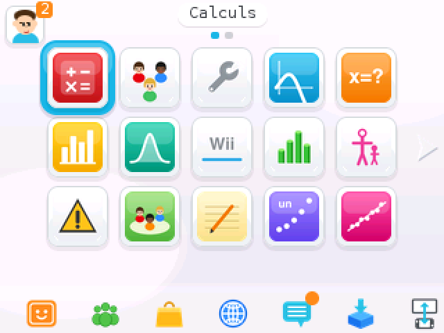

<p align="center">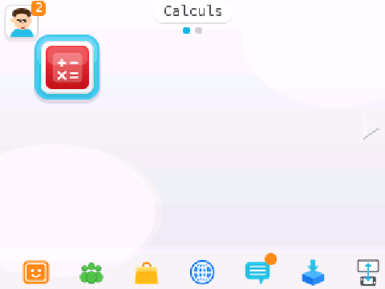</p>

> Captures prises dans le simulateur (horloge réglée sur 14:30). Le
> simulateur ne charge pas de jeux : sur la calculatrice, tes jeux `.nwa`
> ont leur propre tuile, avec leur icône.

## Le menu Wii U

- **Démarrage** : le logo « Wii U », puis l'écran **Avertissement – Santé et
  sécurité** (« Appuie sur OK pour continuer »), puis les tuiles qui
  apparaissent une à une.
- **Les tuiles** : 5 × 3 tuiles par page, plusieurs pages (les points en
  haut), flèches sur les côtés. La tuile choisie s'entoure d'un cadre
  **cyan** qui brille, et son nom s'affiche en haut de l'écran. Ton premier
  jeu prend la place du disque, en haut à gauche.
- **Animations** : les pages glissent, les tuiles apparaissent une à une,
  chaque appli s'ouvre en zoomant depuis sa tuile et se referme en zoomant
  vers elle, et les applis de la calculatrice et les jeux passent par un
  écran de chargement avec leur icône.
- **Déplacer les tuiles** : **Boîte à outils** prend la tuile, les flèches la
  promènent (même vers une autre page), **OK** la pose. Ton menu reste rangé
  comme tu l'as laissé.
- **Ton Mii** en haut à gauche, avec la pastille orange des notifications
  non lues.
- **La barre du bas** : Miiverse, Liste d'amis, Boutique, Navigateur
  Internet, Notifications, Téléchargements et le **bouton TV ↔ GamePad**
  (qui ouvre la Place Mii, comme l'écran de la télé).
- **Le voyant de la calculatrice** s'allume en bleu quand une notification
  arrive, comme la fente du disque de la Wii.

| Santé et sécurité | Sélection | Déplacer une tuile |
| --- | --- | --- |
| 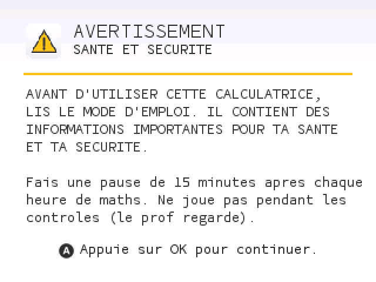 | 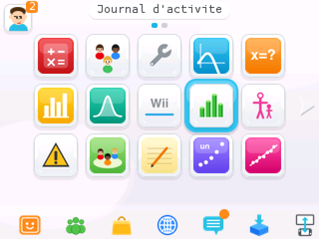 | 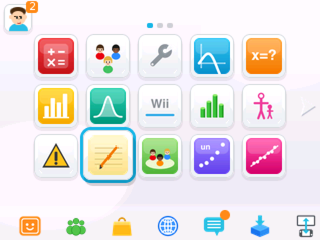 |

## Ce que la calculatrice n'avait pas

| Appli | Ce qu'elle fait |
| --- | --- |
| **Mii Maker** | crée ton Mii : nom, teint, 7 coiffures, couleur des cheveux, yeux, bouche, lunettes, couleur préférée, ou un Mii au hasard. Il apparaît dans le menu, sur Miiverse et sur la Place Mii |
| **Miiverse** | le fil des messages de tes amis, le bouton **Ouah !**, et **tes calculs publiés pour toi** : tape `6×7` dans Calculs, reviens au menu, Miiverse affiche « J'ai calculé 6×7 = 42 ! » (et tes amis y mettent des Ouah !) |
| **Dessin Miiverse** | dessine au crayon et à la gomme, puis publie ton dessin sur Miiverse |
| **Place Mii** | les Miis (le tien et tes amis) se promènent autour de tes applis et parlent dans des bulles ; choisis-en un pour lire son message |
| **Mode Wii** | « Lancement du mode Wii… », puis le **menu Wii** : les chaînes (disque, Mii, photos, boutique, météo, infos), leur écran « Démarrer », la grande horloge |
| **Contrôle parental** | un **vrai code à 4 chiffres** qui bloque les jeux `.nwa`, Python, le navigateur ou Miiverse. Pratique pendant les révisions |
| **Journal d'activité** | le **vrai temps passé** dans chaque appli et chaque jeu, le nombre de lancements, le temps passé dans le menu |
| **Paramètres système** | luminosité, **6 couleurs de sélection**, 3 fonds de menu (blanc, ciel, nuit), réglage de l'heure, infos console (batterie, tension, jeux), accès aux réglages de la calculatrice, et « Formater la console » (essaie) |
| **Liste d'amis** | 10 amis (dont Mme Martin et Prof. Pi), en ligne ou non, ce qu'ils font, leur profil |
| **Boutique** | tes jeux (« Installé ») et des articles qui coûtent trop cher pour ton solde de 0,00 EUR |
| **Navigateur Internet** | les favoris, le chargement… et le célèbre **code d'erreur 103-1101**. Le favori **Aide de Wii U-OS** marche, lui : toutes les commandes |
| **Notifications** | Miiverse, amis en ligne, batterie faible, charge, contrôle parental… |
| **Téléchargements** | la « mise à jour du système 5.5.6 » qui se télécharge, et tes jeux installés |
| **Santé et sécurité** | les conseils de santé (« Bois de l'eau. Les maths donnent soif. ») |

| Mii Maker | Miiverse | Dessin |
| --- | --- | --- |
| 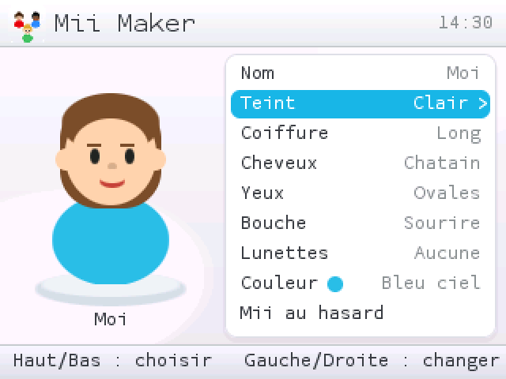 | 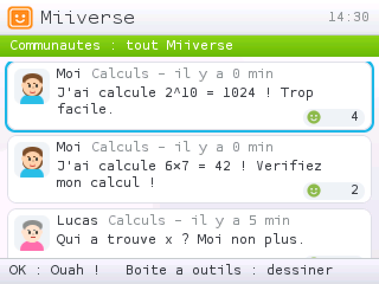 | 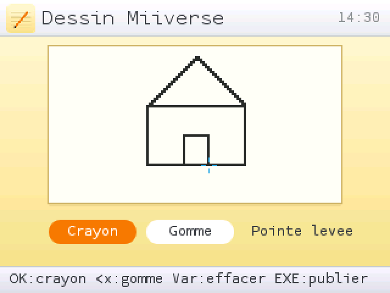 |

| Place Mii | Mode Wii | Contrôle parental |
| --- | --- | --- |
| 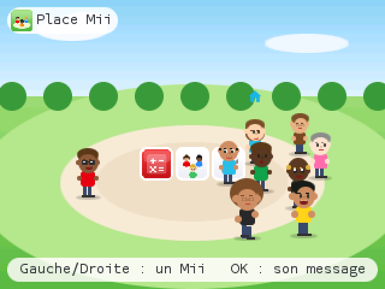 | 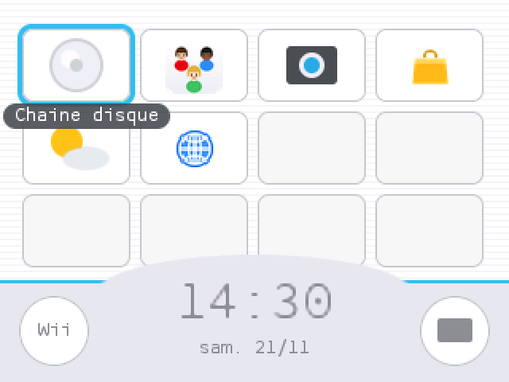 | 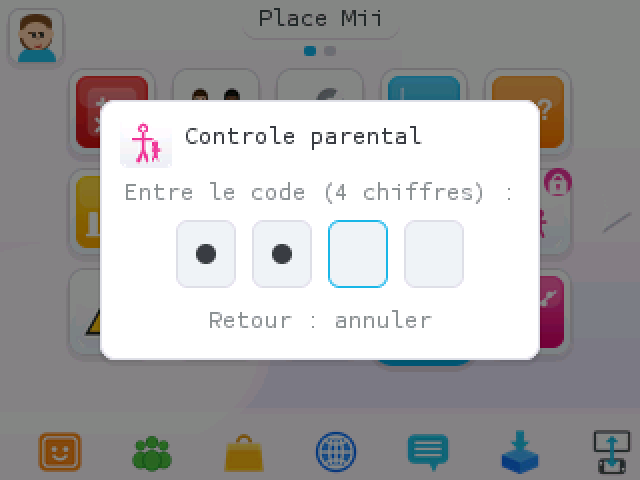 |

| Journal d'activité | Paramètres système | Liste d'amis |
| --- | --- | --- |
| 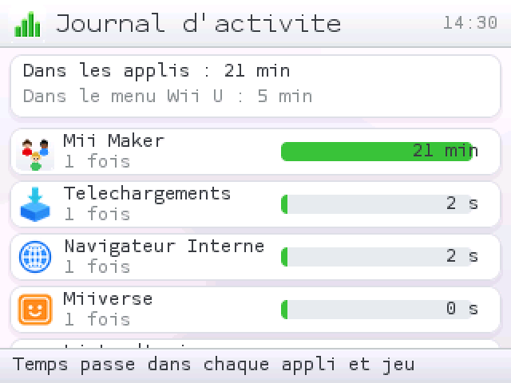 | 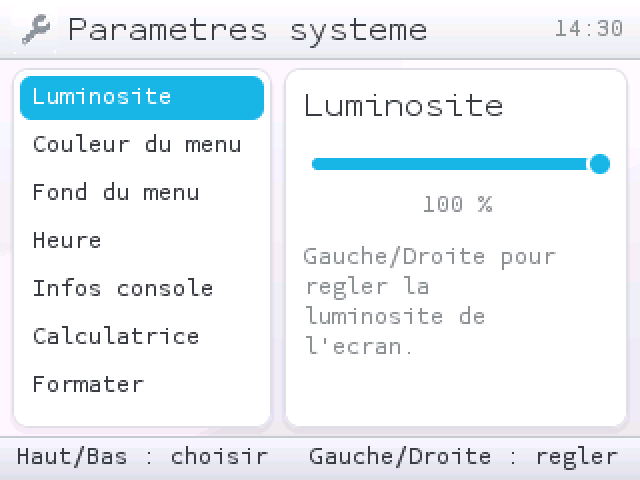 | 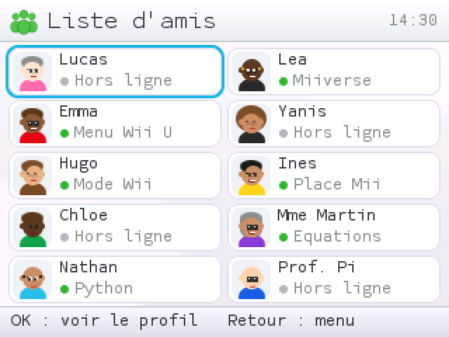 |

| Boutique | Navigateur | Notifications |
| --- | --- | --- |
| 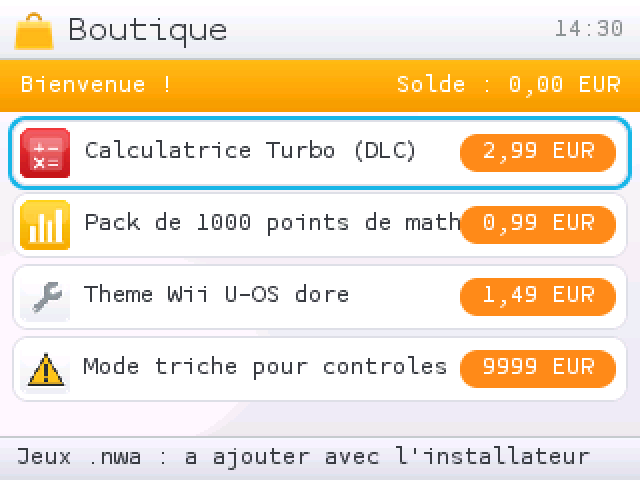 | 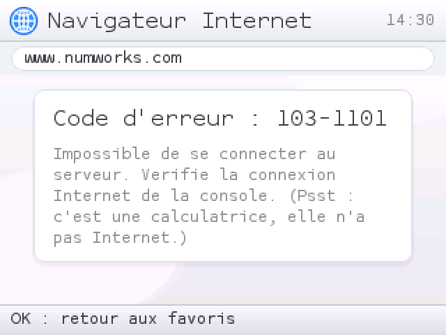 | 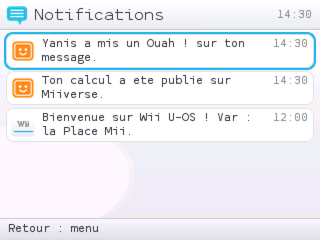 |

<p align="center">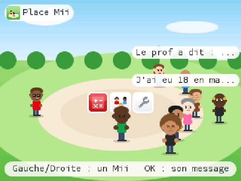</p>

## Commandes

| Touche | Dans le menu | Dans une appli Wii U-OS |
| --- | --- | --- |
| Flèches | choisir une tuile, ton Mii (en haut) ou la barre (en bas) | naviguer |
| OK ou EXE | lancer | valider, Ouah ! |
| Boîte à outils | prendre / poser une tuile | dessiner (Miiverse) |
| Var | Place Mii (bouton TV) | effacer le dessin |
| Retour | revenir à la 1re page | revenir au menu |
| Home | revenir à la 1re page | revenir au menu |
| Chiffres | — | code du contrôle parental |

## Installation

### 1. Obtenir Wii U-OS

Depuis juillet 2021, le code d'Epsilon (le logiciel de la NumWorks) n'est plus
sous licence libre. Wii U-OS ne publie donc **aucun code ni aucun firmware de
NumWorks** : seulement un **patch** (`patches/wiiu-os-epsilon.patch`) et son
propre code. Le firmware se compile à partir des sources officielles de
NumWorks, dans ton compte GitHub ou sur ton Mac.

**Sans rien compiler (Mac ou Windows)**

1. En haut de cette page : **Use this template** > **Create a new repository**,
   coche **Private** (obligatoire : la compilation refuse de tourner dans un
   dépôt public, pour que le firmware ne soit pas téléchargeable par tous).
2. Facultatif : ajoute tes jeux `.nwa` dans le dossier `games/` de ta copie
   privée (*Add file* > *Upload files*). Ils seront préparés et inclus dans
   l'installateur.
3. Dans ta copie : onglet **Actions** > **Build Wii U-OS** > **Run workflow**.
4. Environ 30 minutes plus tard (un firmware par modèle), en bas de la page de la compilation,
   télécharge **WiiU-OS-Mac** ou **WiiU-OS-Windows** et décompresse-le
   (deux fois pour la version Mac : GitHub met le zip dans un zip).

**En compilant sur ton Mac**

```bash
brew install make dfu-util libusb
brew install --cask gcc-arm-embedded
git clone https://github.com/derim00/wiiu-os.git && cd wiiu-os
./scripts/build-firmware.sh
```

Le script télécharge Epsilon au commit indiqué dans `EPSILON_COMMIT`,
applique le patch, compile, prépare les jeux de `games/` et remplit le
dossier `installer/`.

### 2. Installer sur la calculatrice

**Sur Mac**

1. Une seule fois : `brew install libusb dfu-util` (et
   `brew install --cask gcc-arm-embedded` pour ajouter d'autres jeux).
2. Double-clique sur **`Installer WiiU-OS.command`** (la première fois :
   clic droit > **Ouvrir**). La page de l'installateur s'ouvre
   (http://127.0.0.1:8774).

**Sur Windows** (rien à installer : ni Python, ni pilote)

1. Décompresse **WiiU-OS-Windows** (clic droit > *Extraire tout*).
2. Double-clique sur **`Installer WiiU-OS.exe`** (si SmartScreen s'affiche :
   *Informations complémentaires* > *Exécuter quand même*). Laisse la
   fenêtre noire ouverte, ferme-la à la fin pour quitter.

**Ensuite, sur les deux**

3. Branche la calculatrice en USB et appuie sur **Reset** au dos : elle
   redémarre sur le système officiel.
4. Quand le voyant passe au vert, glisse tes jeux `.nwa` dans la page si tu
   veux, puis clique sur **Installer WiiU-OS**.

Seul le **slot B** est écrit : le système officiel (slot A) n'est jamais
modifié.

## À savoir

- **Calculatrice** : NumWorks **n0110**, **n0115** ou **n0120**, logiciel officiel **26.4.0** dans
  le slot A.
- **Trois modèles** : la compilation produit un firmware par modèle
  (n0110, n0115, n0120) et l'installateur choisit tout seul celui de la
  calculatrice branchée. Mets d'abord ta calculatrice à jour sur
  numworks.com : le système doit avoir la même version que le logiciel
  officiel du slot A.
- **Jeux trop gros** : un jeu qui ne tient pas dans le slot B (NumPlay,
  par exemple) est ignoré avec un message, au lieu de faire échouer la
  compilation. Retire-le du dossier `games/`.
- **Un seul système dans le slot B** : Wii U-OS remplace Mint-OS,
  Windows-OS, Switch-OS, PSP-OS… (et inversement). Les installateurs peuvent
  tourner en même temps (Wii U-OS utilise le port 8774).
- **Après un Reset**, la calculatrice revient sur le système officiel, et
  Wii U-OS repart de zéro (Mii, code parental, journal, tuiles rangées) :
  il suffit de relancer l'installation. **Code parental oublié ?** Un Reset
  l'efface aussi.
- **Horloge** : la calculatrice n'a pas d'horloge ; règle l'heure dans
  Paramètres système > Heure.
- **Accents** : la police de la NumWorks n'a pas de lettres accentuées ; les
  textes s'affichent sans accents.
- **Home et On/Off** : le correctif du plantage Home / On-Off de Windows-OS
  et Mint-OS est repris. Home ramène toujours au menu Wii U.
- **Jeux** : seulement des applis `.nwa` dont tu as le droit de te servir, et
  uniquement dans ta copie privée : jamais dans ce dépôt public.

## Comment c'est fait

| Fichier (dans le patch) | Rôle |
| --- | --- |
| `apps/home/wiiu/shell.cpp` | démarrage, Santé et sécurité, grille de tuiles, pages, déplacement des tuiles, barre du bas, notifications, voyant |
| `apps/home/wiiu/apps.cpp` | les 14 applis Wii U-OS |
| `apps/home/wiiu/mii.cpp` | les Miis, dessinés avec des formes (aucune image) à n'importe quelle taille |
| `apps/home/wiiu/gfx.cpp` | rendu par bandes en RAM, texte, images (repris de Mint-OS) |
| `apps/home/wiiu/gen_icons.py` | dessine toutes les icônes dans `wiiu_icons.h` |
| `apps/home/wiiu/calc.cpp` | garde les derniers résultats de Calculs pour Miiverse |
| `scripts/photos.py` | transforme la séance photo du simulateur (`WIIU_SHOTS=dossier`) en PNG et GIF |

## Licence

Le code de Wii U-OS est sous licence **CC BY-NC-SA 4.0** (voir `LICENSE`).
Epsilon reste la propriété de NumWorks et n'est pas inclus dans ce dépôt.
Wii U-OS est un projet de fan, sans lien avec Nintendo ni avec NumWorks ;
Wii U, Mii et Miiverse sont des marques de Nintendo. Les icônes et les Miis
sont des dessins originaux faits pour ce projet.
